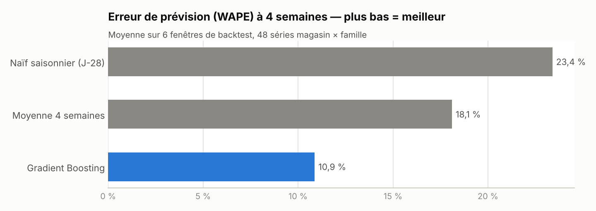
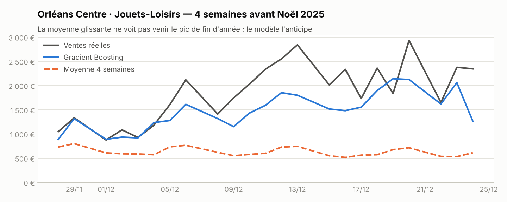

# Prévision des ventes retail à 4 semaines + tableau de bord


> **Tableau de bord interactif : https://ismaildataa.github.io/prevision-ventes-retail/**

Prévision du chiffre d'affaires quotidien à **28 jours** pour un réseau de **8 magasins × 6 familles
de produits** (48 séries), comparaison rigoureuse avec les méthodes utilisées en magasin, traduction de
la précision en **euros de stock**, et un **tableau de bord** filtrable publié automatiquement.

## La question métier

Pour commander la marchandise, un magasin a besoin de savoir ce qu'il va vendre dans les prochaines
semaines. Prévoir trop haut, c'est du stock immobilisé et de la casse sur le frais ; prévoir trop bas,
ce sont des ruptures et des ventes perdues — surtout pendant les pics comme Noël.

## Résultats

| Modèle | Erreur (WAPE) | Erreur avant Noël 2025 | Stock de sécurité nécessaire |
|---|---|---|---|
| Naïf saisonnier (même jour, 4 semaines avant) | 23,4 % | 28,2 % | 48 k€ |
| Moyenne des 4 mêmes jours de semaine | 18,1 % | 21,9 % | 36 k€ |
| **Gradient Boosting** | **10,9 %** | **11,5 %** | **22 k€** |

- **−40 % d'erreur** par rapport à la moyenne glissante, méthode la plus répandue en magasin.
- **−40 % de stock de sécurité** pour le même taux de service (95 %), soit 14 k€ immobilisés en moins
  sur le réseau.
- L'écart est maximal sur la période de Noël, là où une rupture coûte le plus cher.
- Biais de −2,5 % : le modèle ne surestime pas systématiquement.




## Méthode

**Données.** 3,7 ans de ventes quotidiennes synthétiques, construites pour reproduire ce qu'on observe
en grande distribution : tendance par magasin, saisonnalité hebdomadaire (pic le samedi, fermeture le
dimanche), saisonnalité annuelle propre à chaque famille (boissons l'été, jouets à Noël), jours fériés,
veilles de fêtes, opérations promotionnelles.

**Variables.** Ventes à J-28, J-35, J-42 et J-364, moyennes glissantes, jour de la semaine, semaine
de l'année, distance à Noël, jours fériés, promotions planifiées. **Toutes sont connues au moment où
l'on prévoit** : le plus petit retard utilisé est égal à l'horizon (28 jours). C'est l'erreur la plus
fréquente en prévision — utiliser la vente d'hier pour prévoir dans trois semaines — et elle est
vérifiée par un test automatique.

**Modèle.** Un seul Gradient Boosting (scikit-learn) entraîné sur les 48 séries à la fois, sur le
logarithme des ventes pour stabiliser la variance entre petits et grands magasins.

**Validation.** Backtest à origine glissante : 6 fenêtres de 28 jours ; à chaque fenêtre, le modèle est
réentraîné avec les seules données disponibles à cette date. Plus une fenêtre dédiée à Noël 2025.

**Indicateurs.**
- *WAPE* (somme des erreurs absolues / somme des ventes) : se lit directement « on se trompe de X % du CA ».
- *Biais* : le modèle surestime-t-il ou sous-estime-t-il ?
- *Stock de sécurité* = 1,65 × écart-type de l'erreur journalière × √(délai de réappro. de 2 jours) ×
  coût d'achat, sommé sur les 48 séries. Une prévision plus précise exige moins de stock de précaution.

## Le tableau de bord

Page HTML autonome (aucune dépendance externe), publiée sur GitHub Pages et régénérée à chaque mise à jour :

- filtres par magasin et par famille ;
- indicateurs : CA sur 52 semaines et évolution N-1, CA prévu, erreur du modèle sur la sélection ;
- courbe hebdomadaire avec ventes réelles, prévisions du backtest, prévision future et intervalle à 80 % ;
- infobulle au survol, affichage adapté au mobile.

## Démarrage rapide

```bash
git clone https://github.com/ismaildataa/prevision-ventes-retail.git
cd prevision-ventes-retail
pip install -r requirements.txt
python run_forecast.py   # ~25 s : données, backtest, prévision, tableau de bord
pytest -q                # 5 tests, dont l'absence de fuite d'information
```

Sorties : `docs/index.html` (tableau de bord), `outputs/previsions_28j.csv` (prévision par jour,
magasin et famille), `outputs/comparaison_modeles.csv`.

## Structure

```
├── run_forecast.py
├── src/forecast/
│   ├── generate_sales.py   # ventes synthétiques + calendrier des promotions
│   ├── calendar_fr.py      # jours fériés français
│   ├── models.py           # variables, modèles, backtest, métriques
│   └── charts.py
├── templates/dashboard.html.j2   # tableau de bord (SVG + JavaScript natif)
└── tests/
```

## Pistes d'évolution

- Brancher des ventes réelles (par exemple un jeu de données public de distribution).
- Ajouter la météo et les vacances scolaires par zone.
- Passer d'une prévision de CA à une proposition de commande par article.

---

**Ismail Yahyaoui** — Data Analyst · [Portfolio](https://ismaildataa.github.io) ·
[LinkedIn](https://www.linkedin.com/in/ismail-yahyaoui-data-analyst/)
